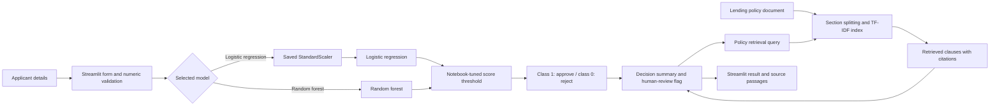

# Midterm Project Progress Report

## System Architecture and Feature Roadmap



The current app loads the saved models and scaler, supports synthetic approval, rejection, and borderline cases, and applies the notebook's thresholds (0.525 for logistic regression; 0.55 for random forest). Logistic regression receives scaled features; random forest receives raw features. The policy assistant splits the bundled document by section, ranks passages with TF-IDF, and builds a constrained response from the retrieved clauses. It shows citations and falls back to human review when no useful passage is found. This prototype does not call a general-purpose LLM.

Retrieval is preferable to relying on an LLM's general knowledge for policy explanations because it can cite the bank-specific source text and expose the exact evidence used. A general model may supply plausible but stale, jurisdictionally wrong, or unsupported rules. Retrieval does not guarantee correctness; the policy itself must be current and approved, and a human must review consequential decisions.

### Roadmap

- Complete: load both models and the scaler; identify class meanings and thresholds from the training notebook; build policy retrieval with citations; add three synthetic demonstration scenarios.
- Next: recover and document category encodings; independently validate thresholds; assess fairness and the `Default_Risk` feature; review the sample policy with a domain expert.
- Before final demonstration: assign team-member names below, rehearse both model paths and the policy fallback, verify cloud deployment, and present evaluation limitations.

## Team Roles and Task Distribution

Names were not included in the project materials. Replace the placeholders with the actual team members before submission.

| Assignment | Owner | Responsibilities |
| --- | --- | --- |
| Data and model validation | Team member to assign | Verify source data and label encoding; reproduce metrics; test feature leakage and threshold selection; document category mappings. |
| Policy and RAG | Team member to assign | Obtain policy approval; maintain sections and citations; evaluate retrieval coverage and unsupported-question fallback. |
| UI, safeguards, and deployment | Team member to assign | Maintain the Streamlit app; validate inputs; check accessibility and fairness disclosures; deploy and smoke-test the public demo. |

## Dataset and Synthetic Data

The notebook downloads the Kaggle dataset `arbaaztamboli/loan-approval-dataset`. It predicts `Loan_Approval_Status`, drops `Applicant_ID`, encodes object columns with `LabelEncoder`, and splits the data 80/20 with `random_state=42`. The checked-in model artifacts contain 25 features. The reported test support is 10,400 records, implying a 52,000-row split in the notebook's run. The raw dataset is not bundled with the app; inference uses only the supplied model files.

The demo profiles are synthetic, fixed examples built to exercise the stored models. They are not real applicants and should not be interpreted as representative of a population. If additional test data is needed, generate synthetic records from reviewed feature ranges and correlations, avoid copying personal information, and assess whether synthetic data preserves harmful bias before using it for evaluation.

## Preliminary Evaluation and Risks

The notebook reports a majority-class baseline accuracy of 65.36%, logistic-regression accuracy of 85.56%, and logistic-regression F1 of 0.8945 at a threshold of 0.525. Five-fold grid search reports a best cross-validation F1 of 0.8865 at `C=0.1`. The notebook reports a random-forest threshold of 0.55 and F1 of 0.8944. Its logistic-regression confusion matrix at the selected threshold is TN=2,548, FP=1,055, FN=444, TP=6,353.

These are preliminary notebook results, not an independent certification. The threshold was selected on the test set whose metrics are then reported, which can make test performance optimistic. The notebook also encodes categorical columns before the split and does not save the category mappings. Rebuild the preprocessing as a fitted pipeline, select thresholds on a validation set, and evaluate once on a held-out test set before drawing performance conclusions.

The model expects `Gender`, a sensitive attribute, and `Default_Risk`, whose definition and provenance are undocumented and may leak target information. Both require investigation; remove them unless there is a lawful, justified, validated basis for use. The app warns users that predictions are demonstrations only, maps class labels using the notebook, and forces a manual-review message for borderline scores. Pickle files can execute code when loaded, so only load artifacts from this trusted repository.

## Security, Prompt Injection, and Guardrails

- There is no generative LLM or open-ended prompt execution in the current app. Retrieved policy text is presented as quoted evidence, not executable instructions.
- Retrieval uses only the bundled policy. Questions with no meaningful match receive a human-review fallback rather than a fabricated policy answer.
- Keep the sample policy visibly marked as illustrative. A real deployment requires a versioned, approved policy and owner review whenever it changes.
- Keep applicant values in memory only; do not persist or log them. Add explicit range, missing-value, and category-code validation before any external use.
- Do not use model output as the final decision. Require documented human review, an explanation based on verified facts, and applicable applicant notices.
- Evaluate disparate impact and proxy effects. The current `Gender` feature makes the supplied models unsuitable for operational lending until resolved.
- Keep Kaggle credentials in environment variables or a secret manager, never in notebooks or source control. The notebook setup now reads `KAGGLE_API_TOKEN` from the environment; revoke the credential that was previously embedded in the uploaded notebook.

## Deployment Strategy and Environment

The intended host is Streamlit Community Cloud, with this GitHub repository as the source, `app.py` as the entry point, Python 3.12 from `runtime.txt`, and dependencies from `requirements.txt`. The app and model files are local in this workspace; deployment requires pushing the intended files and creating the Community Cloud app. Since the connected GitHub repository is public, pushing the pickle files makes them public too. The app uses no API key or external inference service.

Local run command:

```bash
python -m pip install -r requirements.txt
streamlit run app.py
```

## Current Progress and Immediate Next Steps

Completed: notebook-backed class mapping and thresholds; model-specific preprocessing; sample lending policy; TF-IDF policy retrieval with source citations and a no-match fallback; model-specific approval, rejection, and borderline examples; business accountability and prompt-log views; and an editable, assumption-based portfolio loss/profit worksheet. Local Streamlit tests cover the added views and scenario flows.

1. Revoke the exposed Kaggle token and confirm it is absent from any published Git history.
2. Assign actual team members to the role table and review the illustrative policy.
3. Recover category encodings, investigate `Gender` and `Default_Risk`, and retrain/evaluate without leakage.
4. Push only intended files, deploy through Streamlit Community Cloud, and smoke-test the public URL.